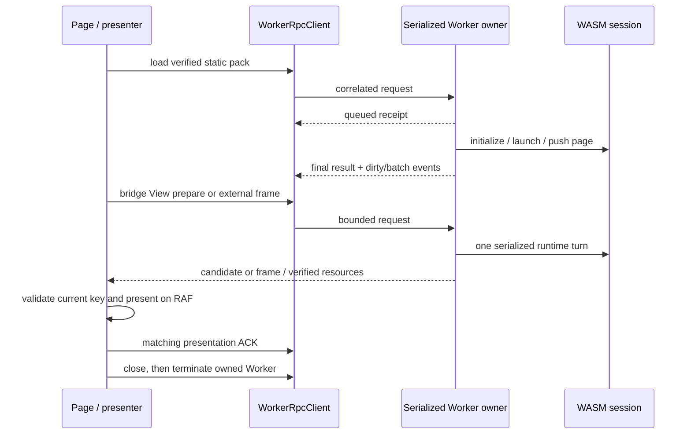

<a id="浏览器工作程序传输"></a>
# Browser Worker transport

[简体中文](browser-worker-transport.md) · **English**


This stage adds a transport and serialized Worker owner for a browser WASM
session. It does **not** switch the existing page to that transport.
[`app.mjs`](../examples/hosts/web-wasm/app.mjs) still imports, constructs and calls
`WebWasmHost` on the main thread. The new modules alone do not establish actual
browser Worker execution, GPU presentation, responsiveness or performance
acceptance. Those require separate integration and recorded browser evidence.

<a id="所有权和执行边界"></a>
## Ownership and execution boundary

- [`worker-session-client.mjs`](../examples/hosts/web-wasm/worker-session-client.mjs)
  exports `WorkerRpcClient` and the pure `measureWorkerPayload` helper. The client
  creates one fresh module Worker through its factory and owns that exact
  instance until termination. A factory must not lend it a shared Worker.
- [`worker-bridge-transport.mjs`](../examples/hosts/web-wasm/worker-bridge-transport.mjs)
  exports `WorkerBridgeTransport`. It adapts a borrowed, session-bound RPC client
  to the existing DOM bridge interface and reuses `SseBridgeTransport` for inner
  request correlation, deadlines and retired View candidate cleanup. It creates
  no runtime or Worker of its own.
- [`runtime-worker.mjs`](../examples/hosts/web-wasm/runtime-worker.mjs) is the
  Worker entry. It imports the WASM package and creates one owner through
  `createWorkerRuntime`.
- [`worker-runtime.mjs`](../examples/hosts/web-wasm/worker-runtime.mjs) validates
  messages, verifies static pack resources, admits bounded work and serializes
  WASM calls. Its message receiver does not enter WASM. Control requests, ordinary
  work and timer turns share one execution lane.

The owner binds its epoch and session on the first `load` or `close` request.
A loaded session is never replaced inside that Worker: another application
session requires a new Worker, epoch and session ID. The owner currently requires
the real QuickJS provider; unavailable engines fail explicitly. It has no
main-thread or HTTP runtime fallback.

Pack loading uses same-origin static HTTP(S) resources. Redirects and runtime
`/api` URLs are rejected. Manifest bytes, the manifest integrity root and blob
SHA-256 values are verified before initialization. An optional index hash pins
the index itself. Hash consistency alone does not authenticate an unpinned index
from an untrusted source.

<a id="邮件和相关性"></a>
## Envelope and correlation

The outer Worker protocol has exactly these seven fields:

```js
{
  version: '1.0',
  workerEpoch: 'epoch-<unique-id>',
  sessionId: 'session-<unique-id>',
  requestId: 'request-<unique-id>.1',
  kind: 'request', // request | response | event | cancel
  op: 'state',
  payload: {}
}
```

`version` belongs to this transport. An inner runtime bridge envelope continues
to use its own `protocolVersion`; the two fields are not interchangeable.
Epoch and session IDs are immutable on the client. Epoch, session and request
namespaces are distinct canonical identifiers, and request IDs use a monotonic
sequence within the client's unique namespace. Responses must match the exact
epoch, session, request ID and operation. A malformed envelope, unexpected
identity, unissued request ID or mismatched operation fails the client closed.
Worker `error` and `messageerror` events use the same failure path.

Accepted work first receives a receipt and eventually a final response:

```js
{ status: 'queued' }
{ status: 'ok', result: /* operation result */ }
{ status: 'error', error: { code: 'ERR_ENGINE', message: '...' } }
```

`queued` confirms admission only. It does not settle the request, clear its
timeout, release its count or byte reservation, or prove that WASM ran. Only a
final `ok` or `error` settles an admitted request. Remote error details remain
available on `WorkerRpcError.details`. A final error for an ordinary operation
does not by itself close a healthy transport.

Worker events use the same outer identity and their own event request IDs.
The owner emits `worker-event-N`, where `N` is a positive decimal safe integer
without leading zeroes. The client requires an increasing sequence for the
whole session; gaps are allowed, while duplicates and older events fail closed
even after their receipt credit has been released. One sequence watermark
prevents replay without retaining an unbounded history.
`dirty` carries state/revision notifications; bridge traces are separate `batch`
events. Events never settle an unrelated request. Revision values crossing this
boundary are canonical decimal strings, avoiding JavaScript integer truncation.

`WorkerBridgeTransport` keeps outer and inner correlation separate. Its ordinary
inner requests travel as outer `bridge` requests containing the original inner
envelope. Returned batches must identify that exact inner request ID and
operation. Each outer request also installs its own `onLateResponse` closure:
a retained late outer final is validated and fed back to the same inner
correlation/retirement path. It cannot settle a later inner request. A late
outer error is reported as a diagnostic rather than synthesized into runtime
success.

`view.abort` uses the reserved outer alias instead of the ordinary `bridge`
lane. The owner creates its own runtime request ID for that alias. The adapter
requires exactly one genuine, non-queued runtime final response for
`view.abort`, then translates only that response's request ID back to the
original inner ID. An outer queued receipt or outer `ok` alone does not authorize
abort success. Events and diagnostics in the batch retain their original IDs.

The runtime can return response-shaped retirement/timer diagnostics with
`requestId: ''`, `op: 'error'`, `payload.ok: false` and a structured error, with
no `queued: true` marker. The adapter admits that precise diagnostic form without
treating it as a correlated response. It cannot settle a request or grant
presentation/input authority. Other response-shaped messages with empty IDs
are rejected.

<a id="操作"></a>
## Operations

`requestHost(op, payload, options)` sends its payload unchanged. The transport
client is generic; the Worker owner admits this explicit operation set:

| Operation | Purpose |
| --- | --- |
| `load` | Verify a static portable pack, initialize AppService and launch a route. |
| `bridge` | Dispatch exactly one `{ envelope }` or one `{ batch: { messages } }`; return the complete `BridgeBatch`. |
| `state` | Read runtime state without reevaluating the View. |
| `frame` | Commit and return an external-renderer frame and revisions. |
| `frame.current` | Read the current external frame without committing another render. |
| `ack` | Acknowledge the matching browser permit or external render revision after presentation. |
| `resource` | Read a verified browser resource using its complete presentation key and SHA-256. |
| `metrics` | Apply logical window metrics through the runtime. |
| `scale` | Change external-frame render density without changing logical dimensions. |
| `retire` / `view.retire` | Retire the owned browser preview. |
| `abort` / `view.abort` | Abort a browser candidate using its key. |
| `events.ack` | Release the exact received event IDs after their client callbacks complete; this is not a presentation ACK. |
| `close` | Stop scheduling, retire the preview and dispose the owned session. |

These operations use object payloads at the owner boundary. `view.prepare` and
other runtime operations travel inside `bridge`; they are not additional outer
Worker operation names. `frame`/`frame.current` and render `scale` require the
external-frame renderer. Browser View preparation uses the runtime's complete
presentation key and permit rather than the external-frame path.

Resource responses transfer an independently owned `ArrayBuffer`. The Worker
copies a WASM byte view before transfer so a response never detaches the WASM
heap. The client likewise accepts transfer lists only for caller-owned attached
ArrayBuffers; transferring a typed-array object or shared memory is rejected.

Successful `frame`, `frame.current` and `surface.recover` responses use
[`worker-frame-wire.mjs`](../examples/hosts/web-wasm/worker-frame-wire.mjs) for
their `result.frame.images` table. Each tightly packed, straight RGBA8 image is
validated and copied into a fresh `Uint8Array` with its own transferable backing.
The source frame and its buffers remain usable after transfer. The client
validates the received dimensions, byte length and complete backing before the
frame reaches its adapter. Ordinary arrays and host API binary values retain
their existing independent validation and budgets.

This frame lane admits at most 1,024 images, dimensions up to 8,192, and at most
16 MiB of pixel bytes in one response. The complete response still has to fit
the ordinary byte, node and depth budgets below; metadata reduces the space
available for pixels. Encoding or budget rejection returns the explicit error
with the genuine final ordered observation, when negotiated, so the owner can
observe the failure without losing the operation's sequence. It grants no
presentation ACK or input authority.

<a id="默认准入预算"></a>
## Default admission budgets

Budgets apply independently on the client and the owner. A client timeout can
release its local reservation while work still exists in the owner's lane;
owner admission must continue counting that work until it is actually removed
or finishes.

| Budget | Default |
| --- | --- |
| Ordinary outstanding requests | 64 |
| Additional generic control slots | 7 |
| Dedicated final `close` slot | 1 |
| Separate inner DOM bridge total / ordinary / reserved abort slots | 64 / 63 / 1 |
| Ordinary request payload | 16 MiB |
| Total outgoing/client or queued/owner payload reservations | 64 MiB |
| Bytes reserved from ordinary work for control operations | 256 KiB |
| Maximum one control payload | 64 KiB |
| Bytes reserved from other control work for `close` | 64 KiB |
| One incoming response or event payload | 16 MiB |
| Ordinary events awaiting client acknowledgement | 64 / 16 MiB total |
| Additional lifetime fault event | 1 / 64 KiB |
| Event IDs per acknowledgement / recent acknowledged-ID memory | 64 / 128 |
| Traversal nodes / depth | 16,384 / 64 |
| Client request timeout / final-close timeout | 5,000 ms / 1,000 ms |
| Retired request retention | At most 256 entries, expiring after 30,000 ms |

Client count limits conservatively use the current total pending count. Its byte
limits and traversal limits are configurable within finite hard ceilings;
increasing client limits does not increase the owner's fixed limits. Request and
response caps cannot exceed 64 MiB, total in-flight bytes cannot exceed 256 MiB,
and traversal cannot exceed 131,072 nodes or depth 256. Control reservations must
leave room for both general control work and close. `inFlightBytes` reports the
client's current outgoing reservations.

The inner bridge has its own correlation table, independent of outer RPC
admission. With its default `maxPending: 64`, ordinary inner operations stop at
63 pending requests so `view.abort` can still reach the outer control reserve.
Increasing an inner limit does not expand either outer count or byte budgets.

The owner's separate pack initialization budget is 128 MiB. The static index is
limited to 2 MiB, manifest bytes to 8 MiB and the blob count to 16,384. The owner
also checks the current JSON initialization boundary's expansion before creating
numeric blob arrays. These are initialization limits, not an increase in the
per-message transport budget.

Before marking a new host ready, the owner measures the complete final load
response against the same byte, node and depth limits as the RPC sender, then
checks the remaining absolute load deadline. A valid pack can still exceed that
response budget. Without a sticky execution/owner fault, rejection unloads and
frees its host before business timers can start. Startup effects and batches
already emitted are not rolled back; this cleanup does not undo application
code that ran before the response was rejected.

Both sides share this synchronous, non-retaining measurement API:

```js
measureWorkerPayload(value, {
  maxBytes: 16 * 1024 * 1024,
  maxNodes: 16_384,
  maxDepth: 64,
  transfers: [],
}) // conservative byte count, or WorkerRpcError
```

Measurement uses an iterative bounded walk over property descriptors, not
`JSON.stringify`, getters or a preliminary structured clone. It charges strings,
metadata and entire backing buffers; repeated references to the same buffer are
charged once, including transfer-only buffers. A tiny typed view therefore
cannot conceal a large backing buffer. Payloads contain finite JSON scalars or
`undefined`, ordinary objects/arrays and attached ArrayBuffers/typed views.
Enumerable plain-object accessors, function/symbol/BigInt values, cycles,
Date/Map/Set and class instances are rejected. Proxies are outside this plain-data
contract. Budget failures report `ERR_RPC_PAYLOAD_TOO_LARGE`; invalid data reports
`ERR_RPC_ARGUMENT`. Data is not truncated or silently converted.

Outgoing validation happens before `postMessage` can clone or transfer the
payload. Incoming validation happens after browser delivery and cannot undo the
browser's prior allocation; the owner must enforce its response/event budget
before sending. Incoming buffers never consume outgoing reservations. Final
responses, cancellation, timeout, transport failure and close all release the
corresponding local outgoing reservations, including error paths.

<a id="事件传递和背压"></a>
## Event delivery and backpressure

Event credit is separate from request reservations. The owner retains a bounded
ledger of the exact IDs and measured payload bytes it has posted. The client
also retains a bounded ledger until its `onEvent` callback finishes, including
an asynchronously returned promise, and the owner's acknowledgement response
arrives. At most one `events.ack` control request is in flight. Its payload is
`{ eventIds: [...] }`; the owner validates the complete list before releasing
anything and returns the acknowledged IDs and remaining event count/bytes.
Unknown IDs cannot create credit. Recently acknowledged IDs are remembered in a
bounded FIFO so a duplicate receipt remains idempotent.

This acknowledgement means that the client received and consumed a notification.
It grants no View permit, input authority or evidence of frame presentation.
DOM and external-renderer presentation continue to use their own matching keys
and presentation ACKs. A rejected callback or malformed receipt fails the exact
client closed rather than acknowledging unconsumed work.

The owner never silently discards a semantic `batch` to keep the connection
running. If a new event cannot fit its count/byte credit, it records a sticky
`ERR_RPC_BACKPRESSURE`, stops business/timer admission and reports the
undelivered operation and size through its one separately reserved fault event.
There is no unbounded pending-event queue. The fault is an explicit failure of
the Worker session; it cannot claim that the unsent batch reached the page or
that its already-applied JavaScript effects were rolled back. State inspection,
diagnostic control and close remain available. Close replies use their separate
control reservation and do not wait for event credit. A new session requires a
new Worker. After an owner fault, explicit retire/abort calls reject and close
skips JavaScript retirement and lifecycle handlers, disposing through the owned
host's low-level unload/free boundary instead.

Runtime state reports its authoritative logical `viewport: { width, height }`,
`lifecycle`, string-valued `templateRevision` and `declaredRendererProfile`.
`rendererProfile` remains the effective profile, which can differ under explicit
host force mode. The declared field reports manifest route policy without
changing or certifying that force mode. The explicit Worker policy below adds
fixed-family admission; product page/presenter integration remains separate work.

Explicit Worker load policy separates semantic profiles from the immutable
transport backend:

```js
{ renderer: 'auto', rendererPolicy: { mode: 'manifest' }, route: 'pages/home/index' }
{ rendererPolicy: { mode: 'force', profile: 'skia' } }
```

`manifest` resolves the requested route against the verified manifest. `webview`
selects `browser-view`; `skia` and `skyline-compat` select `external-frame`. Force
policy deliberately selects that profile for every route and reports both the
declared and effective profiles. With an explicit policy, `renderer` must be
absent or `auto`; a conflicting manually selected transport is rejected.
When policy is omitted, the original low-level behavior remains: the default
`browser-view` path forces WebView, while the existing `external-frame` path
keeps its prior runtime configuration and capability checks. The new returned
`rendererPolicy` is `null` for that legacy contract, not a claim of product auto.

Successful load returns `transportBackend`, `declaredProfile`, `effectiveProfile`
and `rendererPolicy`, retaining the existing `renderer` result alias. Runtime
state exposes `transportBackend` and the explicit policy as well as its existing
profile fields. Worker policy mode checks the host's report against the verified
route policy; an old host silently retaining browser force mode fails explicitly.
This pure host handshake runs before `app.init`, so an unsupported old WASM host
cannot execute startup application code before its policy contract is rejected.
The manifest default is checked as semantic metadata at that point; family
admission waits for the actual requested page and may differ from that default.
The Rust JSON config carries the host-only policy as `renderer_policy`.
Rust embedding keeps the original `WebSessionOptions { renderer_mode }` type
and legacy load methods unchanged. The explicit native entry is
`load_manifest_json_with_renderer_policy(..., options, policy)`; the companion
`parse_config_json_with_policy` returns configuration, legacy options and the
optional typed policy separately. The old two-value parser rejects a supplied
policy instead of losing it. The WASM configuration loader uses the new parser
and dispatches to the corresponding explicit or legacy native load method.

Manifest mode negotiates every profile using the runtime's existing browser
transaction opt-in, including when the initial selected transport is a Skia
frame exporter. This enables protocol operations, not an attached second
presenter or a GPU surface. There is no hidden `renderer_override`; conflicts
with an explicit shared-runtime override are rejected before host replacement.

At the end of each real host turn, a route whose effective profile requires the
other transport family changes the Worker to `restart-required`. One reserved
`fault` event has `origin: 'policy'`, `ERR_UNSUPPORTED_CAPABILITY`,
`requiresRestart: true`, `reason: 'renderer-profile-change'` and a structured
`restartRequired` object identifying the committed route, page ID, old/required
transports and both profiles. The event precedes that operation's final receipt.
The runtime session and already-committed navigation/ACK results remain real;
this is neither an engine execution fault nor an implicit session replacement.
Same-family Skia/Skyline navigation stays runnable in the existing session.

After that boundary, ordinary operations (including frame, input, metrics,
presentation ACK, resource and explicit retire/abort) fail with the structured
restart error, and business timer pumping stops. Read-only `state`, pure
diagnostic/error/cancel bridge operations, receipt ACK and exact-owner close
remain usable. Close skips further JS retirement/lifecycle callbacks and frees
the owned host once. State retains the actual committed page and restart reason.
The future page owner must consume the fault promptly to freeze its presentation
and input; this protocol slice does not implement or test a product UI.

The boundary is a completed synchronous host call, including an entire bridge
batch, timer poll or ready callback. It cannot cancel callbacks or later
envelopes already inside that call. Batches keep their original whole-batch
validation and results; they are not split, replayed or generically prohibited.
Transient routes that return to the original family inside one call are not a
separately observed transition trace. This guard therefore does not implement
the seven-host goal's same-session switching between two attached renderers.
An application manager must explicitly close this owner and create a new
session to restart in the required family; state reset is visible and deliberate.

A `dirty` event carries all those observations alongside `currentPage`,
`viewRevision` and `renderRevision`. Changes to metrics/lifecycle/profile or
native paint can therefore notify a consumer without a template mutation.
`viewRevision` includes accepted input accounting; a dirty event is not a command
to reevaluate WXML/WXS. Consumers must distinguish activity, template demand and
paint invalidation. Repeated identical observations do not republish events.
These latest-state fields are not evidence of the root input consumed by a
prepared or acknowledged frame. Key-bound prepare/frame provenance remains a
separate API requirement; never label ACK-time state as already rendered.

The owner refreshes its local render viewport from every successful state read,
including the read after a failed metrics operation. The error catch refreshes
that local viewport but does not immediately publish a `dirty` event. Product
owners must perform an explicit `state` refresh in their metrics `finally` path
to observe and publish any committed dimensions, while preserving the original
error. An exception can follow an already-committed window update, so a rejected
RPC does not prove rollback. A timer or a later frame may also read state; neither
is a substitute for the product's explicit failure-path observation.
The public next-frame result alone cannot prove which internal observation
refreshed the cached viewport, because `frame` itself reads authoritative state.
The error-path health contract is separately observable: if the host has recorded
an execution fault before throwing, the owner reports a runtime `fault` with
`requiresRestart` and stops business admission without waiting for a later state
request or timer. That fault observation preserves the original operation error.
Rust `executionFault` remains the engine's fault; an owner transport/scheduler
fault is reported separately as `workerFault`. Either makes `requiresRestart`
true, without inventing an engine failure.

<a id="取消和关闭"></a>
## Cancellation and closing

An `AbortSignal` or finite client timeout rejects the original promise and sends
an admission cancellation using the original request identity and operation:

```js
{
  version: '1.0', workerEpoch, sessionId, requestId,
  kind: 'cancel', op,
  payload: { reason: 'timeout' } // or 'aborted'
}
```

No separate cancellation response is required. Queued work can be removed;
asynchronous pack loading can observe its abort signal. A Worker message cannot
preempt a synchronous WASM call already executing on the Worker thread. It also
cannot roll back completed runtime effects. The runtime's own engine deadlines
remain necessary. Defaults are a 5,000 ms bootstrap deadline and a 250 ms turn
deadline; explicit load RPC timeouts must allow for the selected pack-loading
deadline, whose owner default is 30,000 ms.

The total load budget also uses an absolute monotonic deadline, independent of
the Unix clock used to poll AppService timers. Checks surround fetch/WASM
initialization, host construction and each synchronous startup phase, and run
again before ready is returned. A delayed `setTimeout` callback cannot turn an
expired load into success. Host construction clamps the configured bootstrap
and turn limits to the remaining load budget. Each later startup dispatch also
maps its then-current monotonic allowance to an absolute Unix `deadlineNs`;
the runtime takes the earlier of that deadline and its configured turn limit.
The owner emits that nanosecond field as an exact JSON u64 decimal token,
without rounding it through a JavaScript `Number`. Post-checks retain the
monotonic deadline even if the Unix clock changes. A load deadline failure
without a sticky fault unloads and frees the exact host immediately. If Rust
has already recorded an execution fault, the owner retains that faulted realm
for state inspection and pure diagnostic controls until serialized close
disposes it. Event-backpressure faults use the same diagnostic-only lifetime.
Neither path can schedule timers, run business turns or reuse that Worker for
another load. The client's finite close watchdog still terminates its exact
Worker if cleanup cannot finish. Cleanup makes no rollback claim about startup
effects that already ran.

Expired requests are retained only within the bounded retired map. A validated
late final can call `onLateResponse` once, including a late error; it never
resolves the already-rejected original promise. This callback lets a future page
retire a late prepared View candidate. Expired or evicted historical requests are
ignored; retained entries still require an operation match.

`close()` is idempotent and uses the dedicated control slot and byte reserve.
It waits for the correlated final response rather than the queued receipt. The
Worker stops timer admission, cancels queued work and attempts preview retirement,
unload and WASM disposal on its serialized lane. Its final result is
`{ closed: true, diagnostics: [] }`; callers must inspect any returned cleanup
diagnostics rather than treating an ACK as proof of error-free cleanup.

The page-side close watchdog bounds waiting while the main thread remains
responsive. After the final ACK, or on timeout/failure, the client terminates the
exact Worker it created, removes listeners/timers and rejects outstanding
requests. It does not terminate unrelated Workers. Cleanup failures remain
observable through rejected promises and `failure`/`onFailure`; later callback
failures cannot retroactively change an already-settled promise. A silent Worker
that does not emit an error is detected through finite request/close timeouts,
not through a browser Worker exit event.

The bridge adapter borrows the RPC client. Its `dispose()` rejects and cleans up
its own inner transport; it never calls `rpc.close()` or terminates the borrowed
Worker. The page/session owner must dispose the adapter before closing the RPC
client and must explicitly forward session-bound Worker `batch` event payloads
to `receiveBatch()`. Reconnecting that adapter to another session is rejected.

<a id="未来页面集成"></a>
## Future page integration

The intended integration keeps presentation on the page and moves AppService,
View execution and timers into the owned Worker:



The page must reject stale epochs, sessions, generations and presentation keys,
keep its presentation queue bounded, and acknowledge only a frame that actually
reached its selected presenter. Logical metrics and batched input travel back
through the same client; display scaling must not synthesize another View
evaluation. Late candidates need explicit retirement. A generation or poisoned
runtime requiring a new session must close its old Worker before the replacement
becomes authoritative.

The three deterministic transport suites share this command:

```bash
pnpm host:web-worker:test
```

It includes client RPC, serialized owner and bridge-adapter tests. These suites
exercise their injected dependencies and protocol contracts; the command alone
does not establish real browser Worker or WASM execution.

The separate real-Worker boundary harness consumes a passed, clean-source WASM
build from the same Git commit as the current checkout:

```bash
pnpm host:web-worker:smoke -- \
  --site-dir /absolute/path/to/passed-wasm-build \
  --out-dir /absolute/path/to/new-evidence-directory
```

It creates one headless browser and an isolated static server. Three sequential
owned Workers exercise the unchanged original pack's frame export, a clearly
labelled derived pack's timer/deadline probes, and pending View resource
authority. The derived probe does not modify the original pack. Every served
file is retained and hashed, `/api` and external requests are forbidden, and
cleanup results are part of the verdict. No presenter is created and no
presentation ACK is sent. The harness therefore cannot establish DOM layout,
CanvasKit/GPU presentation, input latency or any complete host acceptance gate.
Its existence and syntax validation are separate from a recorded successful run.

Wiring that data flow into `app.mjs`, proving that production WASM executes in a
real module Worker, and measuring DOM/CanvasKit presentation, cleanup and
interaction latency remain separate work. Mocked client/owner tests validate
transport contracts only. This document records no owner-test result, GPU
result, browser performance result or completed goal gate.
