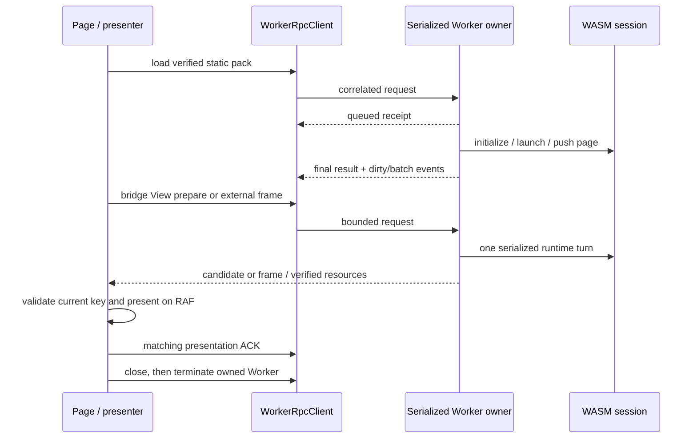

<a id="browser-worker-transport"></a>
# 浏览器工作程序传输

**简体中文** · [English](browser-worker-transport.en.md)


此阶段为浏览器 WASM 会话增加了传输和序列化 Worker 所有权。它**不会**将现有页面切换到该传输。
[`app.mjs`](../examples/hosts/web-wasm/app.mjs) 仍会在主线程中导入、构造并调用 `WebWasmHost`。仅新的模块本身并不能建立实际的浏览器 Worker 执行、GPU 呈现、响应性或性能验收。这些功能需要单独集成并提供浏览器环境的验证证据。

<a id="ownership-and-execution-boundary"></a>
## 所有权和执行边界

- [`worker-session-client.mjs`](../examples/hosts/web-wasm/worker-session-client.mjs)
  导出 `WorkerRpcClient` 和纯 `measureWorkerPayload` 辅助函数。该客户端通过其工厂创建一个全新的模块 Worker，并在其终止前始终拥有该确切实例。工厂不得将该 Worker 借给其他使用方。
- [`worker-bridge-transport.mjs`](../examples/hosts/web-wasm/worker-bridge-transport.mjs)
  导出 `WorkerBridgeTransport`。它将借用的、与会话绑定的 RPC 客户端适配到现有的 DOM 桥接接口，并重用 `SseBridgeTransport` 处理内部请求的相关性、截止时间以及已废弃的 View 候选项清理。它自身不会创建任何运行时或 Worker。
- [`runtime-worker.mjs`](../examples/hosts/web-wasm/runtime-worker.mjs) 是 Worker 入口。它导入 WASM 包，并通过 `createWorkerRuntime` 创建一个拥有者。
- [`worker-runtime.mjs`](../examples/hosts/web-wasm/worker-runtime.mjs) 验证消息、验证静态包资源、接受有限工作量并序列化 WASM 调用。其消息接收器不会进入 WASM。控制请求、普通工作和定时器共享一条执行通道。

所有者在首次收到 `load` 或 `close` 请求时，会绑定其纪元和会话。
加载的会话在该 Worker 内部将永不被替换：另一个应用会话需要一个新的 Worker、纪元和会话 ID。当前所有者需要真实的 QuickJS 提供商；不可用的引擎将明确失败。它没有主线程或 HTTP 运行时的降级方案。

包加载使用同源的静态 HTTP(S) 资源。重定向和运行时 `/api` URL 会被拒绝。在初始化之前，会验证清单字节、清单完整性根和 blob 的 SHA-256 值。可选的索引哈希值会锁定索引本身。仅凭哈希一致性无法验证来自不可信源且未锁定的索引。

<a id="envelope-and-correlation"></a>
## 邮件和相关性

外部 Worker 协议恰好有这七个字段：

```js
{
  version: '1.0',
  workerEpoch: 'epoch-<unique-id>',
  sessionId: 'session-<unique-id>',
  requestId: 'request-<unique-id>.1',
  kind: 'request', // request | response | event | cancel
  op: 'state',
  payload: {}
}
```

`version` 属于该传输。内部运行时桥接信封继续使用自己的 `protocolVersion`；这两个字段不可互换。
时钟和会话 ID 在客户端是不可变的。时钟、会话和请求命名空间是不同的标准标识符，请求 ID 在客户端的唯一命名空间内使用单调递增序列。响应必须完全匹配确切的时钟、会话、请求 ID 和操作。错误的信封、意外的身份、未发出的请求 ID 或操作不匹配将导致客户端彻底失败。
工作程序的 `error` 和 `messageerror` 事件使用相同的失败路径。

已接受的工作首先收到回执，最终会收到最终响应：

```js
{ status: 'queued' }
{ status: 'ok', result: /* operation result */ }
{ status: 'error', error: { code: 'ERR_ENGINE', message: '...' } }
```

`queued` 仅确认接收。它不会结算请求、清除超时、释放计数或字节预留，也不会证明 WASM 已运行。只有最终的 `ok` 或 `error` 才能结算已接收的请求。远程错误详情仍可从 `WorkerRpcError.details` 获取。普通操作的最终错误本身不会关闭健康的传输。

Worker 事件使用相同的外部身份及其自身的事件请求 ID。
拥有者发出 `worker-event-N`，其中 `N` 是一个正的十进制安全整数，不带前导零。客户端要求在整个会话中使用递增的序列号；允许出现间隙，但重复事件或更早的事件即使在回执信用额度释放后也会失败。一个序列水印可防止重放，但需要保留无界的历史记录。
`dirty` 用于传递状态/修订通知；桥接追踪作为独立的 `batch` 事件处理。事件不会对无关请求进行确认。跨越该边界的修订值为标准十进制字符串，以避免 JavaScript 整数截断。

`WorkerBridgeTransport` 将外部和内部的相关性分开。其普通内部请求以外部 `bridge` 请求的形式传输，其中包含原始内部信封。返回的批次必须明确标识该精确的内部请求 ID 和操作。每个外部请求还会安装自己的 `onLateResponse` 闭包：保留的延迟外部最终结果将被验证，并反馈到相同的内部相关性/回收路径中。它不能处理稍后出现的内部请求。延迟的外部错误将作为诊断信息报告，而不是合成为运行时成功。

`view.abort` 使用保留的外部别名而不是普通 `bridge` 通道。拥有者为该别名创建自己的运行时请求 ID。适配器要求对 `view.abort` 恰好一个真实的、非排队的运行时最终响应，然后仅将该响应的请求 ID 转换回原始内部 ID。单独的外部排队回执或外部 `ok` 不能授权 abort 成功。批处理中的事件和诊断保留其原始 ID。

运行时可以返回形如响应的退休/定时器诊断信息，包含 `requestId: ''`、`op: 'error'`、`payload.ok: false` 和结构化的错误信息，且没有 `queued: true` 标记。适配器承认这种精确的诊断形式，但不将其视为相关响应。它无法结算请求或授予呈现/输入权限。其他ID为空的响应形消息将被拒绝。

<a id="operations"></a>
## 操作

`requestHost(op, payload, options)` 将其负载原样发送。传输客户端是通用的；工作线程所有者承认此显式操作集：

| 操作 | 目的 |
| --- | --- |
| `load` | 验证一个静态的可移植包，初始化 AppService 并启动路由。 |
| `bridge` | 恰好分发一个 `{ envelope }` 或一个 `{ batch: { messages } }`；返回完整的 `BridgeBatch`。 |
| `state` | 不重新评估视图的情况下读取运行时状态。 |
| `frame` | 提交并返回一个外部渲染器的帧和修订版本。 |
| `frame.current` | 读取当前外部帧，而不提交另一个渲染。 |
| `ack` | 在呈现之后，确认匹配的浏览器许可或外部渲染修订。 |
| `resource` | 使用其完整的呈现密钥和 SHA-256 验证浏览器资源。 |
| `metrics` | 通过运行时应用逻辑窗口指标。 |
| `scale` | 不改变逻辑尺寸的情况下，改变外部帧的渲染密度。 |
| `retire` / `view.retire` | 退掉所拥有的浏览器预览。 |
| `abort` / `view.abort` | 使用其键中止一个浏览器候选者。 |
| `events.ack` | 在客户端回调完成之后，释放已接收的事件 ID；这并不是一个呈现确认。|
| `close` | 停止调度，回收预览并释放所拥有的会话。 |

这些操作在所有者边界内使用对象有效载荷。`view.prepare` 和其他运行时操作在 `bridge` 内传输；它们不是额外的外部 Worker 操作名称。`frame`/`frame.current` 以及渲染 `scale` 需要外部帧渲染器。浏览器视图准备使用运行时的完整呈现密钥和许可，而不是外部帧路径。

资源响应会传递一个独立拥有的 `ArrayBuffer`。Worker 在传递前会复制 WASM 字节视图，因此响应永远不会使 WASM 堆脱离。客户端同样只接受调用方拥有的已附加 ArrayBuffer 的传递列表；传递 typed-array 对象或共享内存的操作将被拒绝。

成功 `frame`、`frame.current` 和 `surface.recover` 响应使用
[`worker-frame-wire.mjs`](../examples/hosts/web-wasm/worker-frame-wire.mjs) 处理其 `result.frame.images` 表。
每个紧密打包、直线RGBA8图像都会被验证，并复制到一个具有独立可传递后端的全新 `Uint8Array` 中。
源帧及其缓冲区在传输后仍可正常使用。客户端在帧到达适配器之前会验证接收到的尺寸、字节长度和完整后端。
普通数组和宿主 API 二进制值保留其原有的独立验证和预算。

该帧通道最多允许 1,024 张图像，尺寸最大为 8,192，单次响应中像素字节最多为 16 MiB。完整的响应仍必须符合下文所述的普通字节、节点和深度预算；元数据会减少可用于像素的空间。编码或预算拒绝将返回明确的错误，并附带真实的最终有序观察结果（如已协商），从而使所有者能够观察到失败，而不会丢失操作的顺序。它不提供任何呈现确认或输入权限。

<a id="default-admission-budgets"></a>
## 默认准入预算

预算对客户端和拥有者分别独立生效。客户端超时可以释放其本地预留，而拥有者车道中仍存在工作；拥有者准入必须继续计数该工作，直到其实际被移除或完成为止。

| 预算 | 默认 |
| --- | --- |
| 普通待处理请求 | 64 |
| 其他通用控制槽位 | 7 |
| 专用的最终 `close` 槽位 | 1 |
| 分离内部 DOM 桥接总槽/普通槽/保留槽中止 | 64 / 63 / 1 |
| 普通请求数据负载 | 16 MiB |
| 总外出/客户端或排队/所有者有效负载预留量 | 64 MiB |
| 为控制操作保留的普通工作空间字节 | 256 KiB |
| 最大一个控制数据负载 | 64 KiB |
| 为 `close` 保留的来自其他控制工作的字节 | 64 KiB |
| 一个 incoming 响应或事件数据负载 | 16 MiB |
| 待客户端确认的普通事件 | 64 / 16 MiB 总计 |
| 其他生命周期故障事件 | 1 / 64 KiB |
| 每个确认的事件 ID / 最近已确认的 ID 内存 | 64 / 128 |
| 遍历节点 / 深度 | 16,384 / 64 |
| 客户端请求超时 / 最终关闭超时 | 5,000 ms / 1,000 ms |
| 退订请求保留 | 最多 256 个条目，过期时间为 30,000 毫秒 |

客户端数量限制保守地使用当前待处理总数。其字节限制和遍历限制可在有限的硬性上限内进行配置；增加客户端数量限制不会增加所有者的固定限制。请求和响应的大小不能超过 64 MiB，所有飞行中的字节总量不能超过 256 MiB，遍历节点数不能超过 131,072 个，深度不能超过 256。控制预留必须为一般控制工作和关闭操作留出空间。`inFlightBytes` 报告客户端当前的发送预留。

内部桥接器有自己的相关性表，与外部 RPC 入口独立。其默认值 `maxPending: 64`，普通内部操作在 63 个待处理请求时停止，以便 `view.abort` 仍能到达外部控制储备。增加内部限制不会扩展外部计数或字节预算。

拥有者的独立包初始化预算为 128 MiB。静态索引限制为 2 MiB，清单字节限制为 8 MiB，数据块数量限制为 16,384。拥有者还在创建数值型数据块数组之前，会检查当前 JSON 初始化边界是否扩大。这些是初始化限制，而不是每条消息传输预算的增加。

在标记新宿主就绪之前，拥有者会以与 RPC 发送方相同的字节、节点和深度限制来测量完整的最终负载响应，然后检查剩余的绝对负载截止时间。一个有效的包仍可能超出该响应预算。在没有粘性执行/拥有者故障的情况下，拒绝操作会先卸载并释放其宿主，然后再开始业务计时器。已产生的启动效应和批次不会被回滚；此清理操作不会撤销在响应被拒绝之前已运行的应用程序代码。

双方共享这个同步、非持久化的测量 API：

```js
measureWorkerPayload(value, {
  maxBytes: 16 * 1024 * 1024,
  maxNodes: 16_384,
  maxDepth: 64,
  transfers: [],
}) // conservative byte count, or WorkerRpcError
```

测量使用对属性描述符的迭代有界遍历，而不是 `JSON.stringify`、getter 或初步的结构克隆。它会计费字符串、元数据和整个后端缓冲区；对同一缓冲区的重复引用仅计费一次，包括仅用于传输的缓冲区。因此，一个很小的类型视图无法隐藏一个大的后端缓冲区。有效载荷包含有限的 JSON 标量或 `undefined`、普通对象/数组以及附加的 ArrayBuffer/类型视图。可枚举的普通对象访问器、函数/符号/BigInt 值、循环、Date/Map/Set 和类实例会被拒绝。代理不在此普通数据协议范围内。预算失败会报告 `ERR_RPC_PAYLOAD_TOO_LARGE`；无效数据会报告 `ERR_RPC_ARGUMENT`。数据不会被截断或静默转换。

发送方验证在 `postMessage` 复制或转移负载之前发生。接收方验证在浏览器交付之后发生，无法撤销浏览器之前的分配；拥有者必须在发送前强制执行其响应/事件预算。接收缓冲区永远不会消耗发送方的预留。最终响应、取消、超时、传输失败和关闭都将释放相应的本地发送预留，包括错误路径。

<a id="event-delivery-and-backpressure"></a>
## 事件传递和背压

事件信用与请求预留是分开的。拥有者保留了一个有边界的账本，记录了其已发布的事件ID和测量的负载字节数。客户端在`onEvent`回调完成之前（包括异步返回的承诺）也保留一个有边界的账本，且在拥有者确认响应到达后才结束。最多只有一个`events.ack`控制请求正在运行。其负载为`{ eventIds: [...] }`；拥有者在释放任何内容之前会验证完整列表，并返回已确认的ID和剩余事件数量/字节数。未知的ID无法创建信用。最近已确认的ID会被保存在有边界的FIFO队列中，以确保重复回执操作是幂等的。

此确认表示客户端已接收并消费了通知。
它不授予任何视图权限、输入权限或帧呈现的证据。
DOM 和外部渲染器的呈现仍使用自己的匹配键和呈现确认。
若回调被拒绝或回执格式错误，则视为客户端已关闭，而不是确认未消费的工作。

拥有者从不会静默地丢弃语义 `batch` 以保持连接运行。如果新事件无法容纳其计数/字节信用，它将记录一个顽固的 `ERR_RPC_BACKPRESSURE`，停止业务/定时器的准入，并通过其单独预留的故障事件报告未交付的操作和大小。没有无界的待处理事件队列。该故障是工作程序会话的明确失败；它不能声称未发送的批处理已到达页面，或其已应用的 JavaScript 效果已被回滚。状态检查、诊断控制和关闭操作仍然可用。关闭回复使用其独立的控制预留，不会等待事件信用。新的会话需要新的工作程序。在拥有者发生故障后，显式退场/中止调用将被拒绝，关闭操作将跳过 JavaScript 的退场和生命周期处理器，而是通过所拥有的宿主的底层卸载/释放边界进行释放。

运行时状态报告其权威性的逻辑 `viewport: { width, height }`，
`lifecycle`，具有字符串值的 `templateRevision` 和 `declaredRendererProfile`。
`rendererProfile` 保持有效配置，显式宿主强制模式下可能不同。声明字段报告显式路由策略，而不改变或证明强制模式。以下显式 Worker 策略增加了固定族准入；产品页面/呈现器集成仍为独立工作。

显式工作负载策略将语义配置与不可变的传输后端分离：

```js
{ renderer: 'auto', rendererPolicy: { mode: 'manifest' }, route: 'pages/home/index' }
{ rendererPolicy: { mode: 'force', profile: 'skia' } }
```

`manifest` 根据已验证的清单解析请求的路由。`webview` 选择 `browser-view`；`skia` 和 `skyline-compat` 选择 `external-frame`。强制策略故意为每个路由选择该配置文件，并报告声明和实际的配置文件。在有明确策略的情况下，`renderer` 必须不存在或为 `auto`；手动选择的冲突传输会被拒绝。当策略被省略时，原有的底层行为保持不变：默认的 `browser-view` 路径强制使用 WebView，而现有的 `external-frame` 路径保持其之前的运行时配置和能力检查。新返回的 `rendererPolicy` 对于该传统合约为 `null`，并非表示产品自动运行。

成功加载返回 `transportBackend`、`declaredProfile`、`effectiveProfile` 和 `rendererPolicy`，保留现有的 `renderer` 结果别名。运行时状态暴露 `transportBackend` 以及明确的策略及其原有的 profile 字段。工作程序策略模式会检查宿主的报告是否符合已验证的路由策略；旧版宿主在静默保留浏览器强制模式时将明确失败。此纯宿主握手操作在 `app.init` 之前运行，因此不支持的旧版 WASM 宿主在策略合约被拒绝前无法执行启动应用代码。此时会检查清单的默认值作为语义元数据；家族准入会等待实际请求的页面，可能与该默认值不同。Rust JSON 配置携带宿主专属策略作为 `renderer_policy`。Rust 嵌入保持原始 `WebSessionOptions { renderer_mode }` 类型和旧版加载方法不变。明确的原生入口为 `load_manifest_json_with_renderer_policy(..., options, policy)`；其配套函数 `parse_config_json_with_policy` 返回配置、旧版选项和可选的类型化策略，分别返回。旧版双值解析器会拒绝提供策略，而不是丢失它。WASM 配置加载器使用新解析器，并转发到相应的明确或旧版原生加载方法。

Manifest 模式使用运行时现有的浏览器事务选项来协商每个配置文件，包括初始选定的传输方式为 Skia 帧导出器的情况。这仅启用协议操作，而不是附加的第二个呈现器或 GPU 绘制表面。不存在隐藏的 `renderer_override`；如果与显式共享运行时覆盖冲突，则在宿主替换之前会被拒绝。

在每个真实宿主轮次结束时，如果有效配置文件要求其他传输家族发生变化，该路由会将工作程序更改为 `restart-required`。一个保留的 `fault` 事件具有 `origin: 'policy'`，`ERR_UNSUPPORTED_CAPABILITY`，`requiresRestart: true`，`reason: 'renderer-profile-change'`，以及一个结构化的 `restartRequired` 对象，用于标识已提交的路由、页面 ID、旧/所需传输类型以及两个配置文件。该事件在操作最终回执之前发生。运行时会话和已提交的导航/确认结果仍保持真实；这既不是引擎执行故障，也不是隐式会话替换。同家族的 Skia/Skyline 导航将继续在现有会话中运行。

之后，普通操作（包括帧、输入、指标、呈现确认、资源以及显式退订/中止）将返回结构化重启错误，业务定时器泵送停止。只读的 `state`、纯诊断/错误/取消桥接操作、回执确认和精确拥有者关闭仍可正常使用。关闭操作将跳过后续的 JS 退订/生命周期回调，并释放所拥有的宿主一次。状态保留实际提交的页面和重启原因。未来的页面拥有者必须及时处理故障，以冻结其呈现和输入；该协议片段不实现或测试任何产品 UI。

边界是一个已完成的同步宿主调用，包括整个桥接批处理、定时器轮询或就绪回调。它不能取消该调用内部已存在的回调或后续信封。批处理保留其原始的完整批处理验证和结果；它们不会被拆分、重放或普遍禁止。在一个调用内部返回到原始族的临时路由不构成单独观察到的转换轨迹。因此，该保护机制并未实现七宿主目标中在两个附加呈现器之间进行同会话切换。应用管理器必须显式关闭该所有者并创建新会话以在所需族中重启；状态重置是可见且明确的。

一个 `dirty` 事件携带了所有这些观察结果，同时包含 `currentPage`、`viewRevision` 和 `renderRevision`。因此，对度量/生命周期/性能或原生绘制的更改可以通知消费者，而无需模板突变。`viewRevision` 包含已验收输入的统计；dirty 事件不是重新评估 WXML/WXS 的指令。消费者必须区分活动、模板需求和绘制无效化。重复的相同观察不会重新发布事件。这些最新状态字段并不能证明已准备或已确认帧所消耗的根输入。与键绑定的准备/帧来源仍需作为独立的 API 要求；绝不要将 ACK 时刻的状态标记为已渲染。

拥有者从每次成功的状态读取中刷新其本地渲染视口，包括在失败的度量操作之后的读取。错误捕获会刷新该本地视口，但不会立即发布一个`dirty`事件。产品拥有者必须在其度量的`finally`路径中显式执行`state`刷新，以观察和发布任何已提交的维度，同时保留原始错误。异常可能出现在已提交的窗口更新之后，因此被拒绝的RPC并不能证明回滚。定时器或后续帧也可能读取状态；这两种情况都不能替代产品对失败路径的显式观察。仅凭下一帧的结果无法证明是哪个内部观察刷新了缓存的视口，因为`frame`本身也会读取权威状态。错误路径的健康契约是独立可观察的：如果宿主在抛出之前已记录执行故障，那么拥有者将报告一个运行时`fault`，并设置`requiresRestart`，在不等待后续状态请求或定时器的情况下停止业务准入。该故障观察会保留原始操作错误。Rust `executionFault` 仍属于引擎的故障；拥有者传输/调度故障将单独报告为`workerFault`。无论哪种情况，都会使`requiresRestart`为true，而不会虚构引擎故障。

<a id="cancellation-and-closing"></a>
## 取消和关闭

一个 `AbortSignal` 或有限的客户端超时会拒绝原始承诺，并使用原始请求身份和操作发送准入取消：

```js
{
  version: '1.0', workerEpoch, sessionId, requestId,
  kind: 'cancel', op,
  payload: { reason: 'timeout' } // or 'aborted'
}
```

无需单独的取消响应。已排队的工作可以被移除；异步包加载可以观察其中断信号。Worker 消息不能抢占已在 Worker 线程上执行的同步 WASM 调用。它也不能回滚已完成的运行时效果。运行时自身的引擎超时仍然必要。默认值为 5,000 毫秒的启动超时和 250 毫秒的轮询超时；显式加载 RPC 超时必须考虑所选包加载超时，其所有者的默认值为 30,000 毫秒。

总负载预算也使用一个绝对单调截止时间，与用于轮询 AppService 定时器的 Unix 时间钟无关。检查围绕获取/WASM 初始化、宿主构造以及每个同步启动阶段进行，并在返回 ready 之前再次运行。延迟的 `setTimeout` 回调无法将已过期的加载转换为成功。宿主构造会将配置的启动和转限值限制在剩余负载预算内。每个后续启动分发也会将其当时的单调允许值映射到一个绝对的 Unix `deadlineNs`；运行时会取该截止时间与配置的转限中的较早者。所有者会以精确的 JSON u64 小数令牌形式发出该纳秒字段，不会通过 JavaScript `Number` 进行舍入。检查之后即使 Unix 时间钟发生变化，仍保留单调截止时间。若没有粘性故障的负载截止时间失败，将立即卸载并释放该精确宿主。如果 Rust 已经记录了执行故障，所有者将保留该故障域用于状态检查和纯诊断控制，直到序列化关闭时才将其销毁。事件背压故障使用相同的仅用于诊断的生命周期。这两条路径均不能调度定时器、运行业务转或重用该 Worker 用于另一次加载。客户端的有限关闭看门狗仍会在清理无法完成时终止其精确的 Worker。清理不会对已经运行的启动效果提出回滚主张。

过期的请求仅保留在有界的已退请求映射中。一个经过验证的延迟最终值可以调用 `onLateResponse` 一次，包括延迟错误；它永远不会解决已经被拒绝的原始承诺。此回调允许未来的页面退役一个延迟准备的视图候选者。过期或被驱逐的历史请求将被忽略；保留的条目仍需匹配操作。

`close()` 是幂等的，并使用专用的控制槽和字节预留。
它等待相关联的最终响应，而不是队列中的回执。工作程序会停止定时器准入，取消已排队的工作，并尝试在它的序列化通道上进行预览退场、卸载和 WASM 释放。其最终结果为 `{ closed: true, diagnostics: [] }`；调用方必须检查返回的清理诊断信息，而不是将回执视为无错误清理的证明。

页面侧的关闭看门狗在主线程仍保持响应时会持续等待。在收到最终的回执，或在超时/失败后，客户端将终止其创建的精确工作程序，移除监听器和定时器，并拒绝未完成的请求。它不会终止其他无关的工作程序。清理失败仍可通过被拒绝的承诺和`failure`/`onFailure`进行观察；后续回调失败无法逆转一个已经完成的承诺。一个静默的工作程序（未发出错误）是通过有限的请求/关闭超时来检测的，而不是通过浏览器工作程序退出事件。

桥接适配器借用 RPC 客户端。它的 `dispose()` 会拒绝并清理自身内部传输；它从不调用 `rpc.close()` 或终止借来的 Worker。页面/会话所有者必须在关闭 RPC 客户端之前dispose该适配器，并必须明确将与会话绑定的 Worker `batch` 事件负载转发到 `receiveBatch()`。重新连接该适配器到另一个会话会被拒绝。

<a id="future-page-integration"></a>
## 未来页面集成

预期的集成将呈现保留在页面上，并将 AppService、View 执行和定时器移入自有 Worker 中：



该页面必须拒绝过期的时钟、会话、代和呈现密钥，
保持其呈现队列有界，并仅确认确实到达选定呈现器的帧。
逻辑指标和批量输入通过相同的客户端返回；显示缩放不得合成另一个视图评估。
迟来的候选者需要明确退役。一个代或被污染的运行时需要新会话时，必须在替换成为权威之前关闭其旧的工作者。

三个确定性传输套件共享此命令：

```bash
pnpm host:web-worker:test
```

包含客户端 RPC、序列化所有者和桥接适配器测试。这些测试套件验证了其注入的依赖项和协议合约；单独的命令并不能建立真实的浏览器 Worker 或 WASM 执行。

单独的实时工作程序边界套件消耗来自同一 Git 提交的、经过清理的 WASM 构建：

```bash
pnpm host:web-worker:smoke -- \
  --site-dir /absolute/path/to/passed-wasm-build \
  --out-dir /absolute/path/to/new-evidence-directory
```

它创建一个无头浏览器和一个隔离的静态服务器。三个依次执行的自有 Worker 对原始包的帧导出、明确标注的派生包的定时器/截止时间探针，以及待处理的视图资源权限进行测试。派生探针不会修改原始包。每个服务的文件都会被保留并进行哈希处理，禁止访问 `/api` 和外部请求，清理结果是判定的一部分。没有创建呈现器，也没有发送任何呈现确认。因此，该测试框架无法建立 DOM 布局、CanvasKit/GPU 呈现、输入延迟或任何完整的宿主验收门控。其存在性和语法验证与记录的运行成功是相互独立的。

将数据流引入 `app.mjs`，证明生产版 WASM 在一个真正的模块 Worker 中运行，而 DOM/CanvasKit 的呈现、清理和交互延迟的测量仍属其他工作。模拟的客户端/所有者测试仅验证传输协议。本文件未记录任何所有者测试结果、GPU 结果、浏览器性能结果或完成的目标门限。
